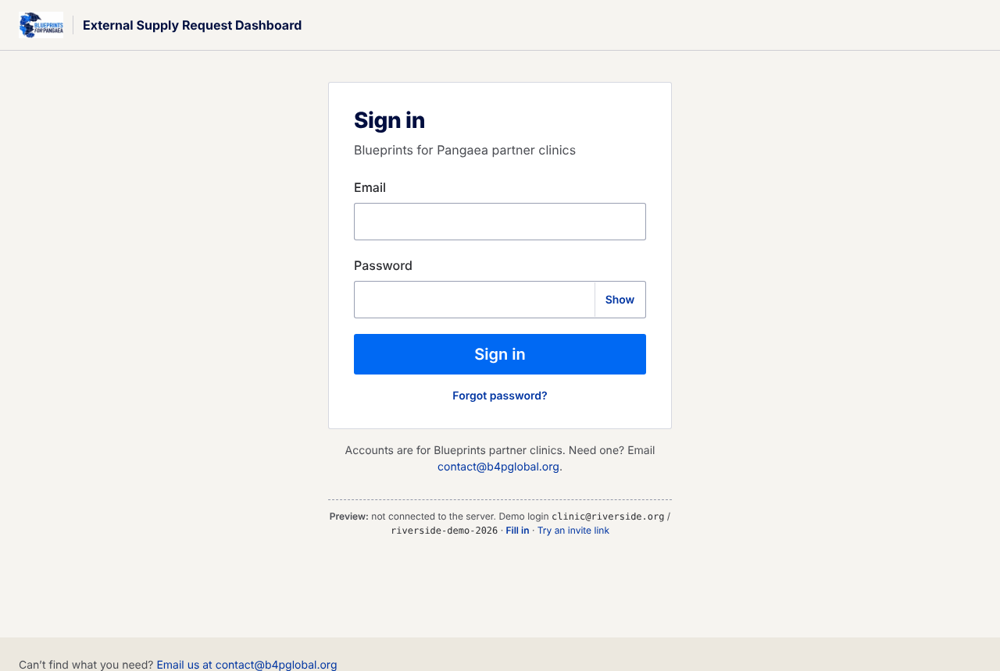
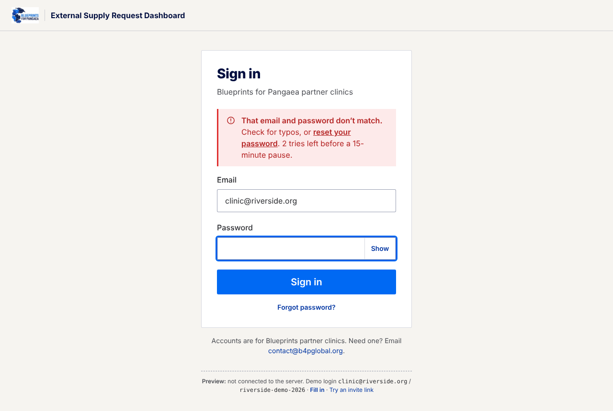
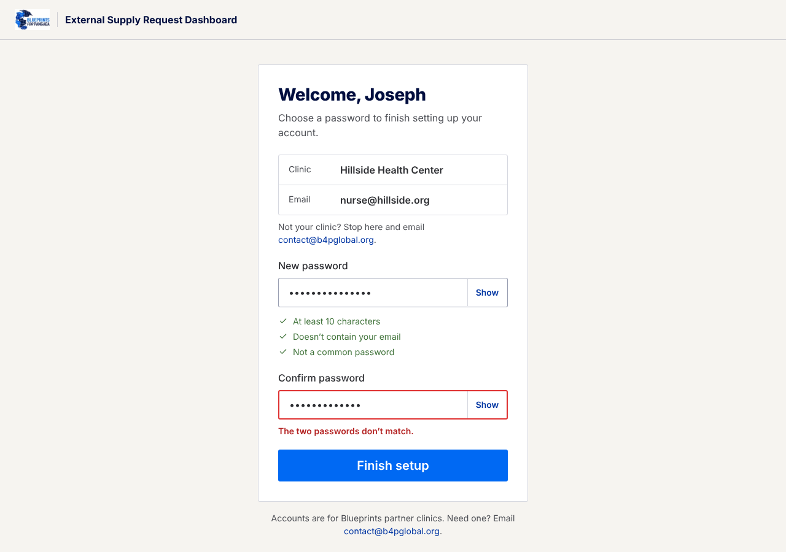
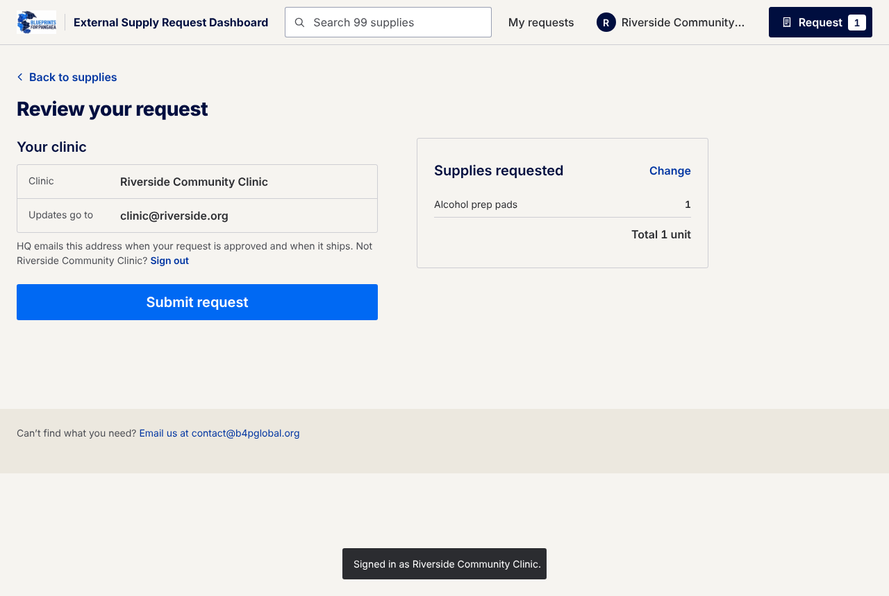
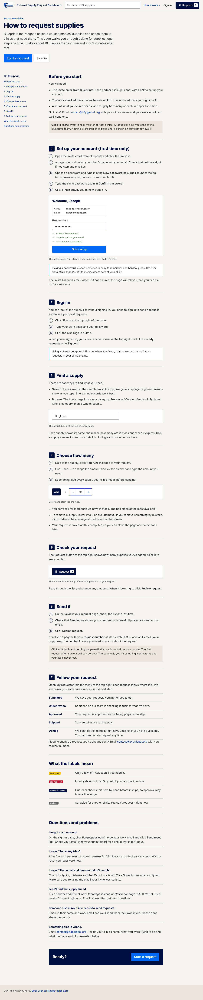
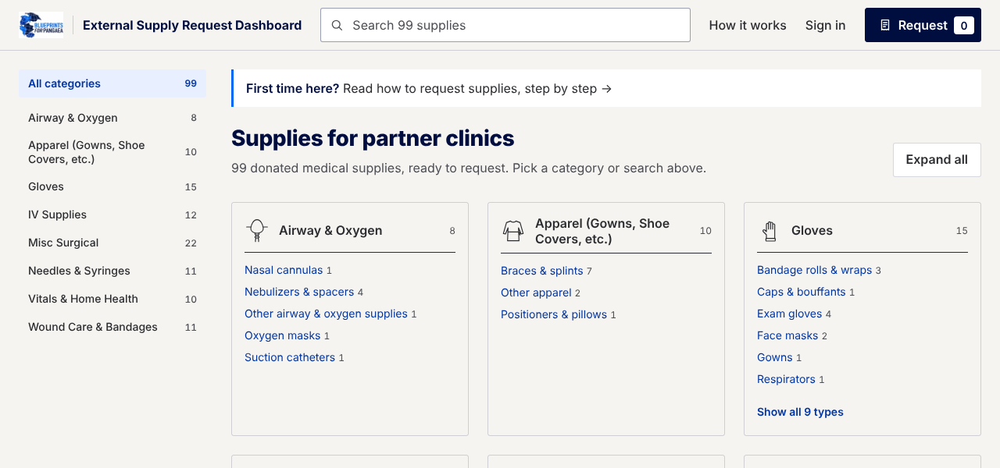
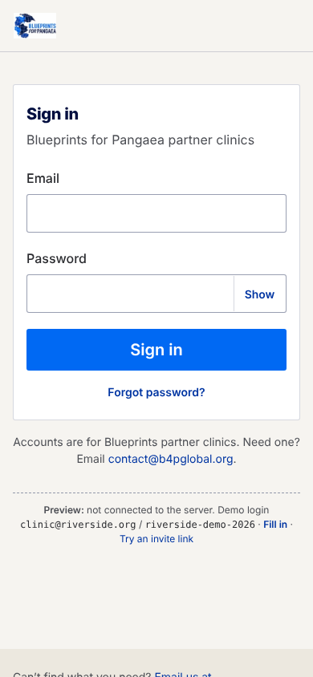
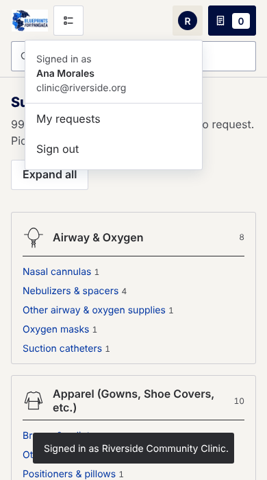

# Login mockup

UI only. The screens run against a fake sign-in in `my-dashboard/src/auth/mockAuth.js`;
nothing talks to the backend yet. A small "Preview" note under every sign-in screen says so.

## Try it

    cd my-dashboard && npm start

- Sign in: `#/signin` with `clinic@riverside.org` / `riverside-demo-2026` (or click **Fill in**)
- Invite link a clinic gets by email: `#/welcome/demo-invite`
- Expired invite: `#/welcome/expired-invite`
- Turned-off account: `closed@example.org` / `closed-account-1`

## How to request supplies (`#/how-it-works`)

A step-by-step guide for clinic staff who aren't comfortable with computers: what you need
before starting, then 7 numbered steps (set up account, sign in, find a supply, choose how
many, check, send, follow), what the status names and labels mean, and answers to common
problems (forgot password, locked out, can't find a supply, adding a colleague). Small
pictures drawn with the app's own styles show what each button looks like. It's linked from
"How it works" in the header ("Help" on phones), a "First time here?" bar on the home page,
and the sign-in page. It loads only when opened, so it doesn't slow the supply list.

## What it does

- **Browsing stays open.** Sign-in is asked for at "Review your request" and "My requests".
  The request in progress is kept while you sign in.
- **Invite-only accounts.** HQ sends each clinic a link; the clinic sees its name and email
  and only chooses a password. There is no public sign-up.
- **Signed in:** the header shows the clinic, with My requests and Sign out. Checkout shows
  "Sending as" instead of the name/email fields. My requests shows the clinic's requests
  without typing an email.

## Checks during sign-in

- Email trimmed and lowercased; must look like an email; 254 characters max.
- Password required; 128 characters max.
- One message for a wrong email *or* password, so the page doesn't reveal who has an account.
- After a miss the password field is cleared; with 3 or fewer tries left it says how many.
- 5 misses pause sign-in for 15 minutes, with the time it reopens and a reset-password link.
- Turned-off accounts get their own message pointing to HQ.
- Caps Lock warning, Show/Hide password, no double submits, focus moves to the first problem.
- New passwords: 10+ characters, not containing the email, not a common password, typed twice.
- Forgot password always says "if this email has an account", for the same reason.

## Before it's real

- Swap `mockAuth.js` for calls to `/auth/*`, and `useAccount.js` for `GET /auth/me`.
  The session should be an HttpOnly cookie, not localStorage.
- The server has to repeat every check above; the browser checks are only for clear messages.
- `REACT_APP_AUTH_PREVIEW=off` turns the sign-in step off (the existing App tests run that way).

## Look

Restyled to match the Blueprints website revamp: Public Sans, warm paper background (#f6f4f0),
navy headings (#000e3f), blue buttons (#0069f3), 3px corners, sand footer. Tokens are at the
top of `styles.css`. Public Sans loads from Google Fonts, so `npm run budget` reports
"External fonts: 3 found"; drop the three `<link>` lines in `public/index.html` to go back
to the system font.

The JS budget (all chunks) now reads 85.5 KB / 80 KB: about 4.5 KB is the guide, which is a
separate chunk loaded only on `#/how-it-works`; the main bundle is about 81 KB.

## Screens

| Sign in | Wrong password |
|---|---|
|  |  |

| Invite setup | Checkout, signed in |
|---|---|
|  |  |

| Guide | Home page link |
|---|---|
|  |  |

| Phone: sign in | Phone: account menu |
|---|---|
|  |  |
